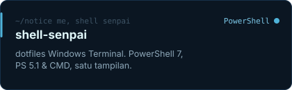
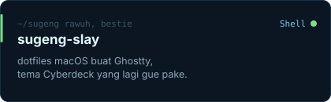
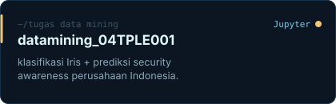
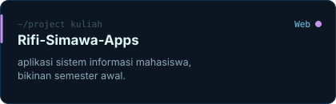

 

Halo. Gue anak Teknik Informatika yang lebih sering ngoprek terminal daripada ngerjain tugas.

Repo-repo di sini isinya hal yang lagi gue pelajarin, gue tulis ulang biar nggak lupa. Kadang rapi, kadang berantakan, yang penting jalan dulu.

 

  
  
  
  

 

**Yang biasa gue pake**

  

Lagi ngulik: ricing terminal di Windows & macOS, UI kecil-kecilan, sama data mining buat tugas kuliah. Sisanya nulis di <a href="https://bachtyar-syah.blogspot.com">blog</a>.
