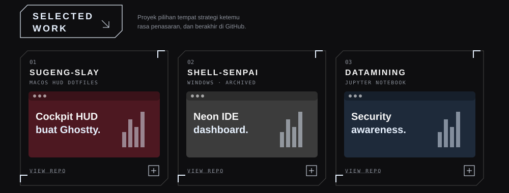
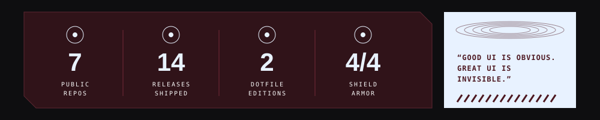
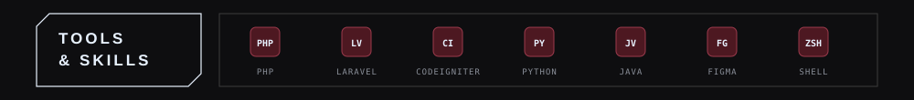

<a href="https://github.com/NullIvy/sugeng-slay">sugeng-slay</a> · <a href="https://github.com/NullIvy/shell-senpai">shell-senpai</a> · <a href="https://github.com/NullIvy/datamining_04TPLE001">datamining</a>

