 

<code>// TECH STACK</code>

  

 

 

 

<table align="center" width="100%">
<tr><td>

<code>// ABOUT</code>

### Belajar dengan cara ngoprek — lalu dicatat biar nggak lupa.

Mahasiswa **Teknik Informatika, Universitas Pamulang**. Repo di sini adalah jurnal belajar sekaligus portofolio: dari bikin web app, ngulik data, sampai ricing terminal sampai kelihatan *slay*.

`#web-dev` · `#ui-ux` · `#dotfiles` · `#data-mining` · `#gadget`

</td></tr>
</table>

 

<code>// FEATURED PROJECTS</code>

| Project | Deskripsi | Stack |
|:--|:--|:--|
| 🐚 **[shell-senpai](https://github.com/NullIvy/shell-senpai)** | *Notice me, Shell Senpai* — dotfiles Windows Terminal: PowerShell 7, PS 5.1 & CMD via Clink | `PowerShell` `Clink` |
| 🌃 **[sugeng-slay](https://github.com/NullIvy/sugeng-slay)** | *Sugeng rawuh, bestie* — cyberpunk dotfiles macOS, Ghostty + tema Cyberdeck | `Shell` `Ghostty` |
| 🧠 **[datamining_04TPLE001](https://github.com/NullIvy/datamining_04TPLE001)** | Klasifikasi Iris & prediksi *security awareness* perusahaan Indonesia (Decision Tree) | `Python` `Jupyter` |
| 🎓 **[Rifi-Simawa-Apps](https://github.com/NullIvy/Rifi-Simawa-Apps)** | Aplikasi sistem informasi mahasiswa — project kuliah | `Web` |

 

<code>// ACTIVITY</code>

  

 

 

<code>// CURRENTLY NGOPREK</code>

  

`🐚 Terminal ricing (Win + macOS)` &nbsp; `🎨 UI/UX & frontend` &nbsp; `📊 Data mining & ML dasar` &nbsp; `☕ Java GUI`

  

  

❯ <i>“ngoprek dulu, paham belakangan.”</i> — NullIvy

